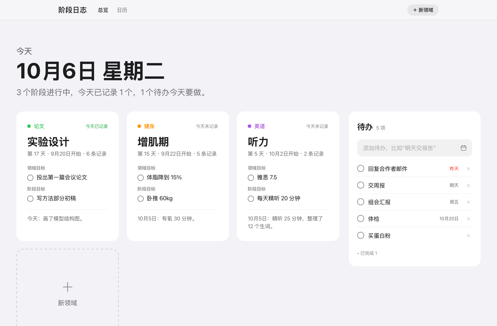
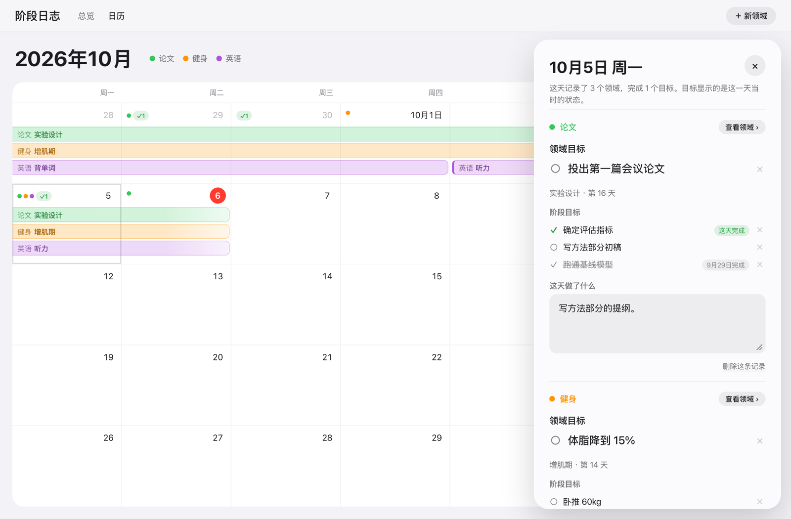
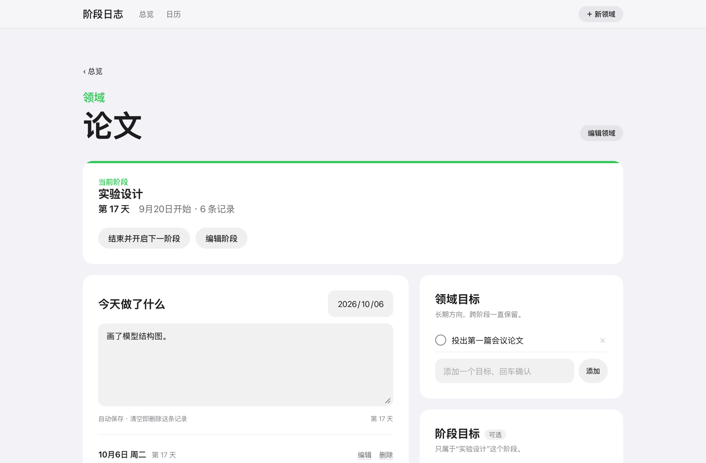
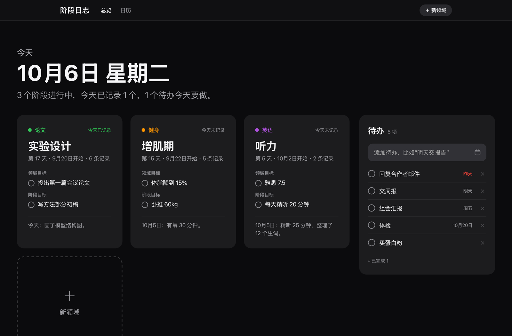

# 阶段日志 · Phase Log

[English](README.en.md) | 中文

按「领域 → 阶段 → 每一天」记录自己的成长。一个苹果风格的 macOS 小应用，数据全部存在本地。



## 为什么做这个

待办清单只告诉你今天要做什么，却很难看出这段时间自己在往哪里走。

阶段日志把生活分成几个**领域**，比如论文、健身、英语。每个领域一次只进行一个**阶段**，比如“文献调研 → 实验设计 → 写作”。每天写下在这个阶段做了什么；阶段结束时写个总结，再开启下一个。时间久了，日历上会留下一条条彩色的阶段，能清楚看到自己走过的路。

## 功能

- **领域与阶段**：每个领域一次进行一个阶段，显示进行到第几天、写了多少条记录。随时可以结束当前阶段、开启下一个；结束时可以写总结，没完成的目标可以带到下一阶段。
- **每天记录**：写下今天在这个阶段做了什么，自动保存；以前的日子也可以补写。
- **两种目标**：领域目标是长期方向，跨阶段一直保留；阶段目标只属于当前阶段（可选）。每个目标都会记下创建和完成的日期。
- **全屏日历**：每个阶段是一条横跨日期的彩色条；有记录的日子有彩色圆点，完成目标的日子有 ✓。点任意一天，可以查看、补写那天的记录，看到那天完成的目标和当时的目标。
- **待办**：参考滴答清单的快速添加。输入“明天交周报”“周五组会”“10月20日体检”“3天后还书”，会自动认出日期；认错了点一下 × 就好。
- **时期感悟**：写下一段时间的想法。开始新的一段时，旧的会归档，随时可以回看。
- **顺滑的切换**：在日历里点“查看领域”，领域名会飞到详情页的大标题，返回时再飞回去。
- **原生 Mac App**：独立窗口和程序坞图标，跟随系统深色模式，退出前自动保存。
- **只存在本地**：数据就是一个 `data.json` 文件，每天第一次保存时自动备份。没有账号，也不联网。

| 日历 | 领域详情 |
|---|---|
|  |  |



## 安装

需要 macOS 12 或更新版本（目前在 macOS 26 上测试过），以及 Xcode 命令行工具（里面有 Swift 编译器和 Python 3）。

```bash
xcode-select --install          # 已经装过可以跳过
git clone https://github.com/ryanchen20071105-dotcom/phase-log.git
cd phase-log
./app/build.sh                  # 编译出 阶段日志.app
open 阶段日志.app
```

之后把 `阶段日志.app` 拖到程序坞，点一下就能打开。如果项目放在“桌面”或“文稿”里，第一次打开时 macOS 会问能否访问这个文件夹，点“允许”。

不想编译，也可以直接用浏览器：

```bash
python3 server.py               # 会自动打开 http://127.0.0.1:8790
```

## 使用小提示

| 快捷键 | 作用 |
|---|---|
| ⌘1 / ⌘2 | 总览 / 日历 |
| ⌘N | 新领域 |
| ⌘+ / ⌘− / ⌘0 | 放大 / 缩小 / 实际大小 |
| ⌘R | 重新载入 |
| Esc | 关闭日历右侧的面板 |

- 删除目标、记录或待办后，屏幕底部会出现“撤销”，6 秒内点它就能恢复。
- 触控板两指向右滑，可以回到上一页。

## 数据

- 所有内容都保存在项目文件夹里的 `data.json`。这个文件已经写进 `.gitignore`，不会被提交。
- 每天第一次保存时，旧文件会复制到 `backups/data-日期.json`。
- 换电脑时，把 `data.json` 复制过去就行。

## 项目结构

```
index.html        界面和全部逻辑（一个文件，没有依赖）
server.py         本地服务：提供页面、读写 data.json、每日备份（只用 Python 标准库）
app/main.swift    原生 App：WKWebView 窗口，负责启动和关闭本地服务
app/icon.swift    用代码画出 App 图标
app/Info.plist    App 的基本信息
app/build.sh      编译并组装 阶段日志.app
启动.command       双击打开 App（还没编译时退回浏览器版）
```

## 开发

- 改了 `index.html`，在 App 里按 ⌘R 就能看到；改了 Swift 代码，重新运行 `./app/build.sh`。
- 测试时不要碰真实数据，可以换一个端口和数据文件：

  ```bash
  PORT=8799 DATA_FILE=/tmp/test.json NO_BROWSER=1 python3 server.py
  ```

- App 也支持几个测试用的环境变量：`PHASELOG_PORT`、`PHASELOG_DATA`、`PHASELOG_TEST_JS`、`PHASELOG_SNAPSHOT`、`PHASELOG_QUIT`，用法见 `app/main.swift`。

## 许可证

[MIT](LICENSE)
